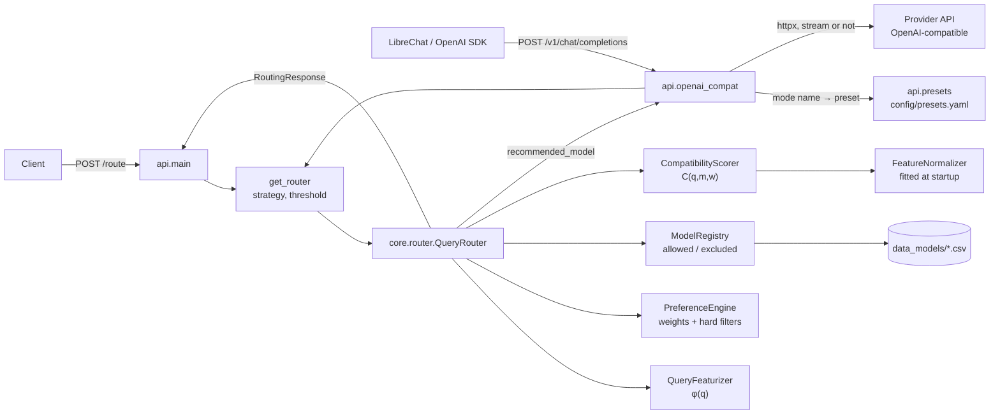

# Architecture

QueryRouter++ answers one question per request: *which model should serve this query, given what
the caller cares about?* It is a stateless scoring service. There is no trained model at inference
time: a query is turned into a heuristic feature vector, every eligible model is scored on four
axes from static CSV data, and the axes are combined with caller-supplied weights.

## Package layout

```
src/queryrouter/
├── _paths.py            repo-root locations of data_models/ and config/presets.yaml
├── core/                pure routing logic (no I/O except reading the CSVs once)
│   ├── query_featurizer.py      φ(q): 28-dim heuristic feature vector
│   ├── model_registry.py        ψ(m): model profiles, allow/deny filtering
│   ├── compatibility_scorer.py  C(q, m, w) and the four axis scores
│   ├── preference_engine.py     preferences → weights, hard budget/latency filters
│   └── router.py                QueryRouter: strategies, tool-aware weight shift
├── data/                CSV loaders (ModelProfile) and min-max normalizers
├── api/                 FastAPI surface
│   ├── main.py                  /route, /explain, /models, /health
│   ├── openai_compat.py         /v1/models, /v1/chat/completions (route, then proxy)
│   ├── presets.py               LibreChat "modes" from config/presets.yaml
│   ├── schemas.py               Pydantic request/response models, preset weights
│   └── dependencies.py          process-local router cache
└── evaluation/          offline RouterEvaluator (accuracy vs oracle, cost, CO₂)
```

Dependency direction: `api → core → data`. `core` imports the Pydantic request types from
`api.schemas`; that is the one upward edge and the first thing to move if the core is ever
packaged without FastAPI.

## Request flow



`QueryRouter.route()` does, in order:

1. **Resolve weights.** `UserPreferences` turns `optimize_for` into a weight vector
   (`PRESET_WEIGHTS` in `api/schemas.py`) or validates a `custom` vector (four keys, sum = 1).
2. **Featurize** the query: φ(q) ∈ [0, 1]²⁸ — length and sentence stats, 8 domain scores, 10
   task-type scores (keyword lists), expected output length, reasoning depth, language, code/math
   presence, creativity, factual precision. Regex and word lists only; no network call.
3. **Tool-aware shift.** If `tool_context` reports native tools (web search, file search, code
   exec, artifacts, plugins) add δ = 0.30 to `w_performance`; MCP or a persisted agent adds 0.15;
   total capped at 0.40. The other three weights shrink proportionally, so Σ wᵢ = 1 still holds.
4. **Filter** the pool: `allowed_models` / `excluded_models`, then hard constraints
   (`budget_per_query_usd` against a 1,000-token estimate, `max_latency_ms`; unknown latency passes).
5. **Score and pick** with the configured strategy, return every eligible model's score and
   per-axis breakdown, the estimated cost and latency of the winner, and a one-line explanation.

The OpenAI-compatible path adds two steps around this: the requested `model` name (or a
`routing_preference` field) selects a LibreChat preset with its own weights, `allowed_models`,
strategy and cascade threshold; after routing, the original chat request is forwarded to the
chosen provider's OpenAI-compatible endpoint with the provider key from the environment, and a
`queryrouter` metadata block is injected into the response (first SSE chunk when streaming).

## Scoring function

```
C(q, m, w) = w_P·P(q,m) + w_K·K(q,m) + w_L·L(q,m) + w_E·E(q,m),   w ∈ Δ³, every axis ∈ [0, 1]
```

| Axis | Computation (`core/compatibility_scorer.py`) |
|------|----------------------------------------------|
| **P** performance | Task-type scores of φ(q) are mapped to benchmarks (`TASK_BENCHMARK_MAP`: coding → HumanEval, math → GSM8K + MATH, reasoning → GPQA Diamond + MMLU, others → MMLU), normalized into weights, dotted with the model's min-max-normalized benchmark vector. Missing benchmarks are mean-imputed. |
| **K** cost | Query-specific: 150 input tokens plus 50–500 output tokens from φ(q)'s expected-length feature, priced with the model's $/1M rates, min-max scaled across the pool and inverted. |
| **L** latency | `1 − latency_ms / max_latency` over the pool; 0.5 when the model has no latency figure. |
| **E** ecology | Inverted min-max of inference CO₂ g / 1M tokens; falls back to the inverted cost score when a model has no CO₂ figure. |

Normalizers are fitted once per `QueryRouter` instance on the whole registry, so scores are
relative to the current model pool: adding a model can change every other model's score.

### Strategies

| Strategy | Decision |
|----------|----------|
| `direct` (default) | `argmax_m C(q, m, w)` over the eligible pool. |
| `cascade` | `complexity(q) = 0.65·max(reasoning, coding, math) + 0.35·length`. Below τ (default 0.6) take the cheapest eligible model, at or above τ the most expensive. All models are still scored for the response. |
| `embedding` | P is replaced by the cosine similarity between φ(q) and the model's normalized profile vector ψ(m), mapped to [0, 1]; K, L, E as in direct. This is the heuristic feature vector, not a learned embedding. |

The strategy is chosen per request on `/route` and `/explain` through `context.strategy`
(unknown values fall back to `direct`) and per preset on `/v1/chat/completions`.

## Model registry and data sources

The registry is three CSV files in `data_models/`, joined on `model_id` by `data/loaders.py`:

- `models_benchmark_matrix.csv` — MMLU, HumanEval, GSM8K, MATH, GPQA Diamond, Arena Elo
- `models_cost_matrix.csv` — $/1M input and output tokens, context window, average latency
- `models_eco_matrix.csv` — parameter counts, training and inference CO₂ estimates, confidence level

Each row carries a source URL and a HIGH / MEDIUM / LOW confidence tag; collection method and
caveats are in `data_models/README.md`. `config/presets.yaml` holds the four LibreChat modes;
if it is missing or invalid the built-in defaults in `api/presets.py` are used.

Both directories sit at the repository root (resolved by `_paths.py`) so operators can edit or
volume-mount them; the Docker image copies them to `/app`.

## Extension points

| To… | Change |
|-----|--------|
| Add or update a model | Add a row to each of the three CSVs (same `model_id`). Normalizers refit on startup. |
| Make it reachable through the proxy | Its `provider` must be a key of `PROVIDER_CONFIG` in `api/openai_compat.py`; set the provider's API key, and optionally `QUERYROUTER_<PROVIDER>_BASE_URL`. |
| Add a preset | `PRESET_WEIGHTS` and the `optimize_for` literal in `api/schemas.py` (native API) or a block in `config/presets.yaml` plus `MODE_TO_PRESET` (LibreChat modes). |
| Tune tool-aware routing | `QueryRouter(tool_boost={"delta_first_class": …, "delta_mcp": …, "cap": …})`. |
| Add a benchmark to P | Column in the benchmark CSV, `BenchmarkNormalizer.BENCHMARK_NAMES`, `BENCHMARK_NAMES` and `TASK_BENCHMARK_MAP` in the scorer. |
| Add a strategy | A `_route_<name>` method in `QueryRouter`, a branch in `route()`, and the `Strategy` literal. |
| Compare strategies offline | `evaluation.RouterEvaluator.evaluate()` / `compare_strategies()`; `scripts/evaluate_on_librechat.py` replays queries from a LibreChat MongoDB and compares the router's pick with the model actually used. |

## Limits

- **Heuristic featurizer.** Task and domain detection are English keyword lists and regexes. They
  are cheap and explainable, and they miss paraphrases and other languages.
- **Embedding strategy is not semantic.** It reuses φ(q); no sentence encoder is loaded.
- **Static, relative scores.** Benchmarks, prices and CO₂ come from CSV snapshots and are
  min-max normalized over the pool. Many CO₂ figures are LOW confidence estimates.
- **Cost is an estimate.** K assumes 150 input tokens, the budget filter assumes 1,000 tokens; the
  real prompt length is not used.
- **Cascade does not retry.** It picks cheapest or strongest once from query complexity; there is
  no answer-quality check and no escalation on failure.
- **No auth, quotas or persistence.** The API has no authentication, CORS allows every origin,
  router instances are cached per process, and upstream calls use a fixed 120 s timeout with no
  retries. Put it behind a gateway before exposing it.
- **Anthropic needs a shim.** The proxy speaks the OpenAI wire format; Anthropic models need an
  OpenAI-compatible base URL (for example a LiteLLM proxy).
- **`eco_mode` is reserved.** It is accepted for compatibility and currently ignored.
